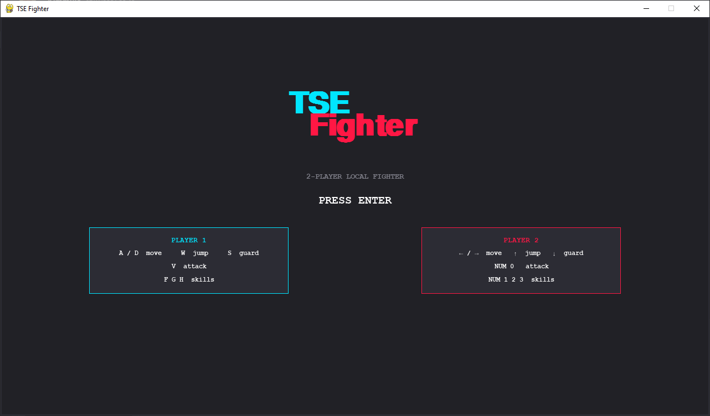
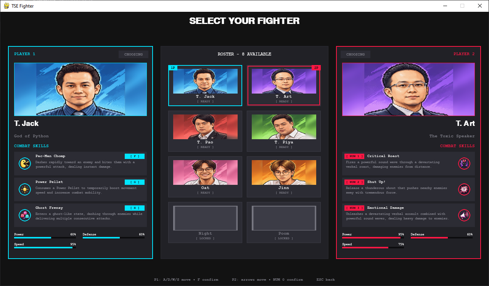
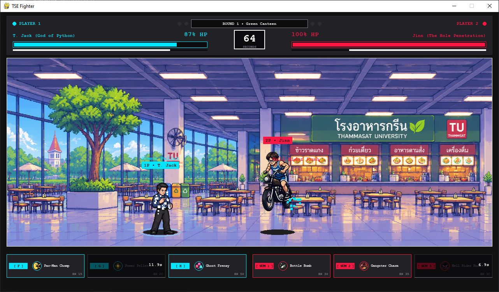
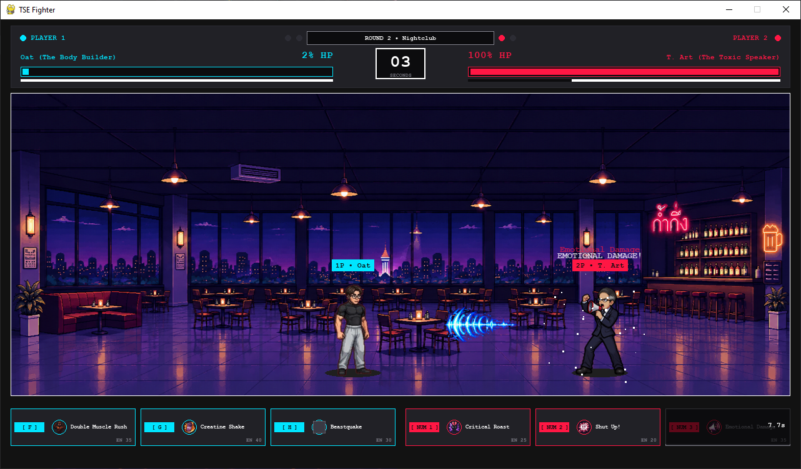
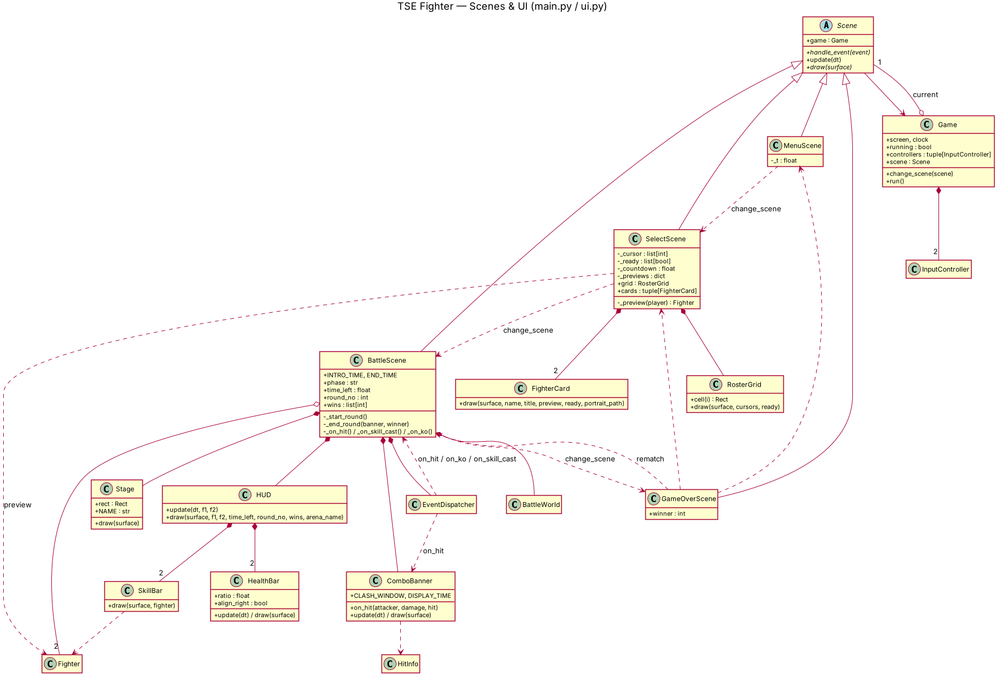
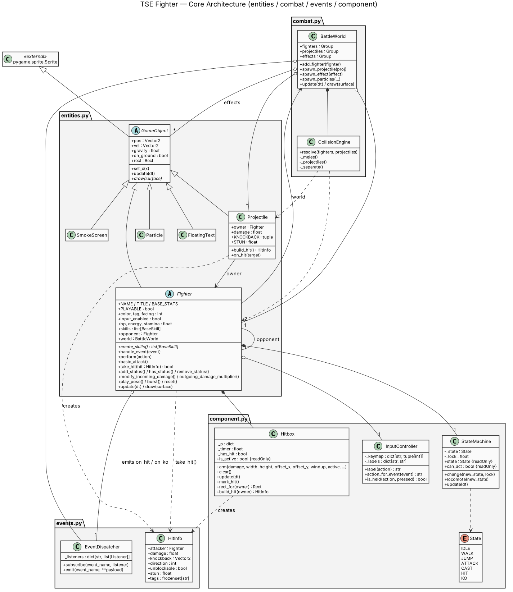
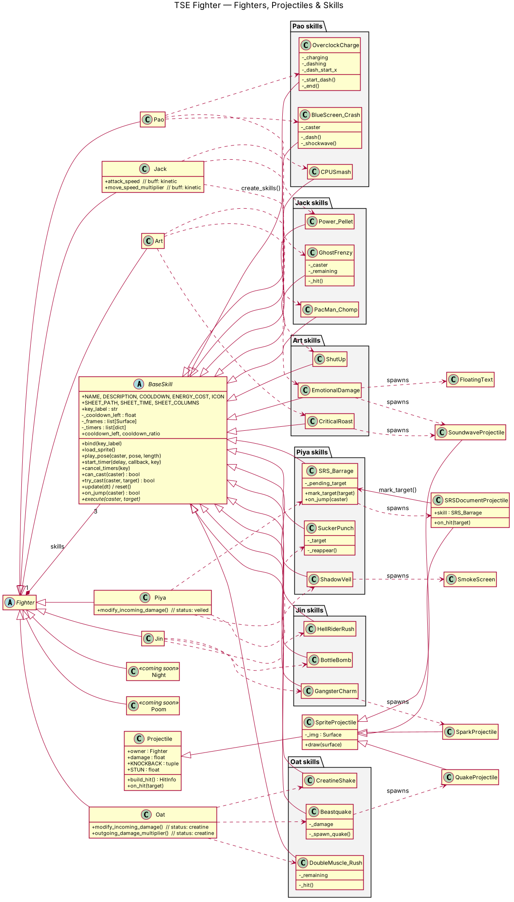

# TSE Fighter

<p align="start">

   
  
</p>


## ✨ Overview
**TSE Fighter** is a fast-paced, Street Fighter-style 2D fighting game built in Python using **Pygame**, developed as a final project for an **Object-Oriented Programming (OOP)** course.

Inspired by life at the **Thammasat School of Engineering (TSE)**, every fighter in the roster is based on real people from the faculty—complete with custom stages modeled after familiar campus spots and special skills that parody their signature habits and behaviors.

Jump straight into the action from the launch screen, pick your fighter, and battle it out in classic head-to-head arcade combat—available as a standalone Windows executable or directly from source.


## 📥 Download

### GitHub Releases (Recommended)

Download the latest exe. from the Releases page.

https://github.com/Kimmuie/TSE_Fighter/releases

### Local Download

Install TSE Fighter directly from repository.

```
pip install pygame>=2.5
python main.py
```

## 🖥 Built With

  <table>
  <tr align="center">
    <td width="100">
      <a href="https://react.dev" title="Python">
        
      </a>
    </td>
  </tr>
  <tr align="center">
    <td>Python</td>
  </tr>
</table>

## 📸 Screenshots

<table>
<tr>
<td align="center">

<br><b>Launch Page</b>
</td>

<td align="center">

<br><b>Character Selection</b>
</td>
</tr>
<tr>
<td align="center">

<br><b>Fighting Scene</b>
</td>

<td align="center">

<br><b>Fighting Scene</b>
</td>
</tr>
</table>

## 📸 UML Diagram

<table>
<tr>
<td align="center">

</td>
</tr>
<tr>
<td align="center">

</td>
</tr>
<tr>
<td align="center">

</td>
</tr>
</table>

## ⭐ Support

If you enjoy TSE Fighter, consider giving this repository a ⭐.

It helps more people discover the project and supports future development.
